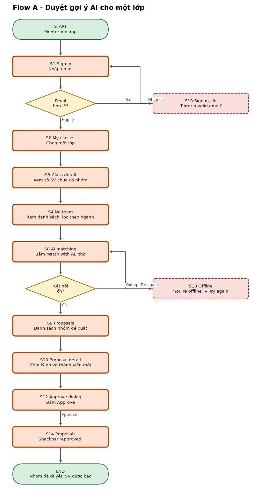
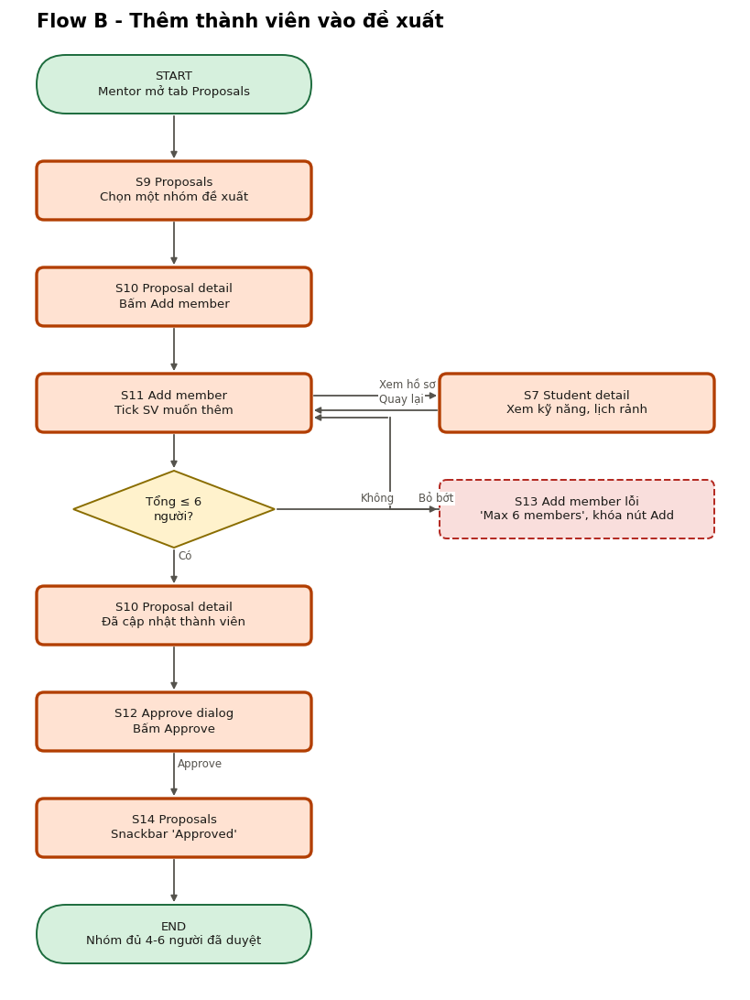
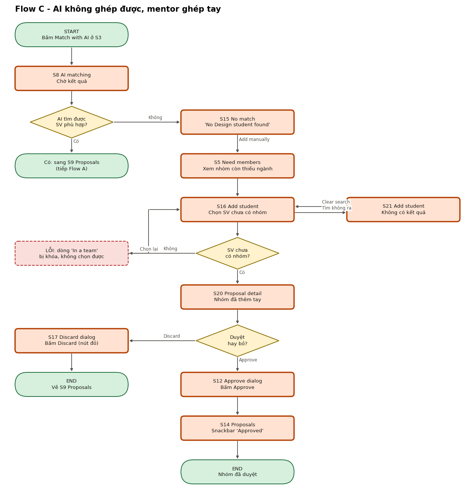

# User flow, IA và danh sách màn hình

Người dùng chính: Cô Lan (mentor). Sinh viên chỉ xuất hiện như dữ liệu trong app, không có giao diện riêng.

## 1. Danh sách màn hình (21)

Số thứ tự trùng với thứ tự frame trong Stitch và tên trang Figma.

| # | Màn hình | Vai trò | Ghi chú |
|---|---|---|---|
| S1 | Sign in | Vào app | Chỉ nhập email, không có bước mã |
| S2 | My classes | Tab Classes | 3 lớp, mỗi lớp 2 dòng trạng thái |
| S3 | Class detail | Tổng quan lớp | Số SV chưa có nhóm, số nhóm thiếu người, nút Match with AI |
| S4 | No team | Danh sách SV chưa có nhóm | Lọc theo ngành |
| S5 | Need members | Danh sách nhóm còn thiếu | Hàng ngành + dòng "Needs ..." |
| S6 | Profile | Tab Profile | Thông tin mentor, Sign out |
| S7 | Student detail | Hồ sơ SV | Ngành, kỹ năng, lịch rảnh |
| S8 | AI matching | Loading | Chờ AI |
| S9 | Proposals | Tab Proposals | Danh sách nhóm đề xuất kèm nhãn mức phù hợp |
| S10 | Proposal detail | Chi tiết đề xuất | Lý do, thành viên, Approve, Discard |
| S11 | Add member | Chọn SV thêm vào nhóm | Chọn nhiều, đếm "x of 6" |
| S12 | Approve dialog | Xác nhận | Dialog |
| S13 | Add member - Error | Lỗi vượt 6 người | "Max 6 members", khóa nút |
| S14 | Proposals - All matched | Empty + snackbar | "Approved" + Undo |
| S15 | No match | AI không tìm được | "Add manually" |
| S16 | Add student | Ghép tay | Dòng "In a team" bị khóa |
| S17 | Discard dialog | Hủy đề xuất | Dialog nút đỏ (destructive) |
| S18 | Offline | Lỗi mạng | "Try again" |
| S19 | Sign in - error | Lỗi email sai | Ô Email viền đỏ, "Enter a valid email" |
| S20 | Proposal detail - hand-built | Chi tiết nhóm ghép tay | Chip "Added by you", Approve, Discard |
| S21 | Add student - no results | Tìm không ra SV | "No student found", "Clear search" |

## 2. Cây điều hướng

```
Sign in (S1)
└─ Bottom navigation: Classes | Proposals | Profile
   ├─ (lỗi email: Sign in S1 → S19 → Continue → Classes)
   ├─ Classes (S2) → Class detail (S3) → No team (S4) → Student detail (S7)
   │                                  → Need members (S5) → Add student (S16) → Proposal detail hand-built (S20)
   │                                                                            → No results (S21) → S16
   │                                  → Match with AI → AI matching (S8) → Proposals (S9) | No match (S15)
   ├─ Proposals (S9) → Proposal detail (S10) → Add member (S11) → Student detail (S7)
   │                                        → Approve dialog (S12) → Proposals (S14)
   │                                        → Discard dialog (S17)
   └─ Profile (S6)
```

## 3. Ba flow (có đường lỗi)

| Flow | Mục tiêu | Đường lỗi | File |
|---|---|---|---|
| A | Duyệt gợi ý AI cho một lớp | Email sai (S19); mất mạng khi AI chạy (S18) | `assets/flows/flow-a.drawio`, `flow-a.png` |
| B | Thêm thành viên vào đề xuất | Tổng vượt 6 người | `flow-b.drawio`, `flow-b.png` |
| C | AI không ghép được, mentor ghép tay | SV đã có nhóm; tìm không ra SV (S21); hủy đề xuất (Discard) | `flow-c.drawio`, `flow-c.png` |

Ba file được sinh từ `assets/flows/build_flows.py` (chạy `python3 build_flows.py` để vẽ lại cả `.drawio` lẫn `.png`).

### Flow A


### Flow B


### Flow C


## 4. Bảng phủ màn hình

| Màn | Flow A | Flow B | Flow C |
|---|---|---|---|
| S1 Sign in | x | | |
| S2 My classes | x | | |
| S3 Class detail | x | | (điểm bắt đầu) |
| S4 No team | x | | |
| S5 Need members | | | x |
| S6 Profile | | | |
| S7 Student detail | | x | |
| S8 AI matching | x | | x |
| S9 Proposals | x | x | (kết nối Flow A) |
| S10 Proposal detail | x | x | |
| S11 Add member | | x | |
| S12 Approve dialog | x | x | x |
| S13 Add member - Error | | x | |
| S14 Proposals - All matched | x | x | x |
| S15 No match | | | x |
| S16 Add student | | | x |
| S17 Discard dialog | | | x |
| S18 Offline | x | | |
| S19 Sign in - error | x | | |
| S20 Proposal detail - hand-built | | | x |
| S21 Add student - no results | | | x |

S6 Profile là một tab của thanh điều hướng, không nằm trong flow nghiệp vụ nào; nó có trong Final UI và prototype dưới dạng điểm đến của tab.
